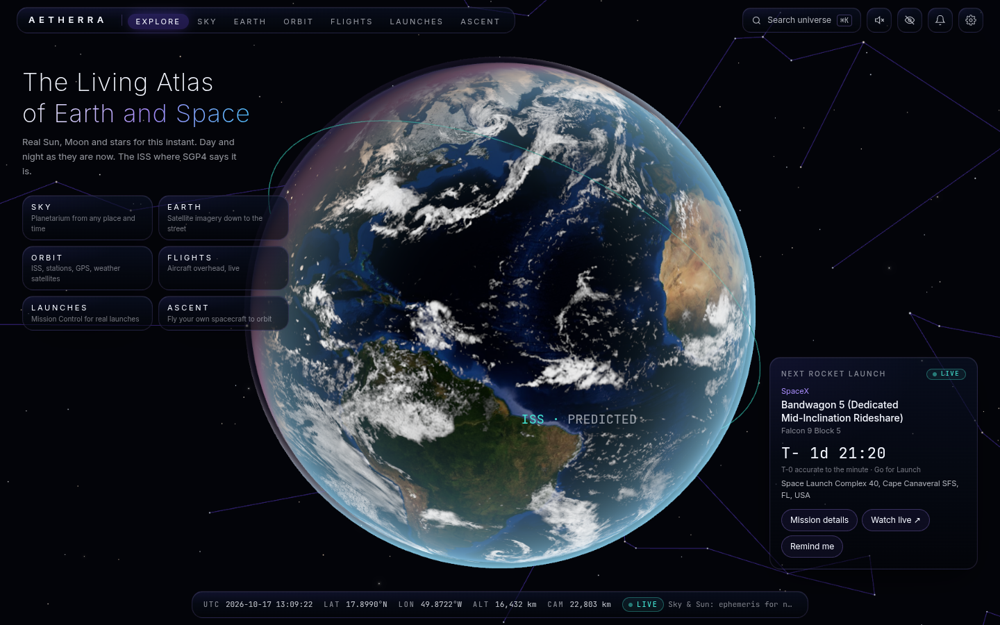
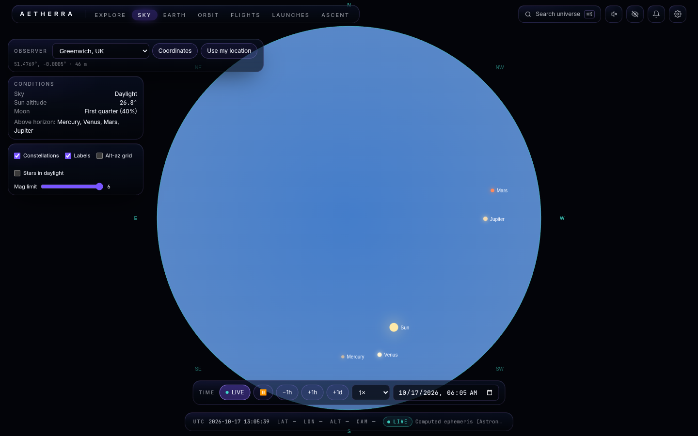
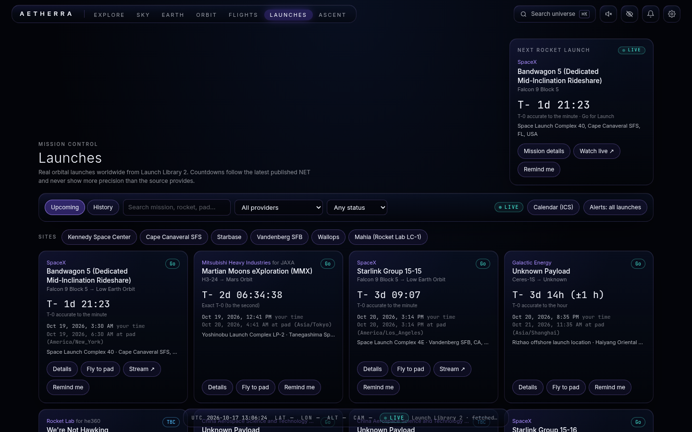
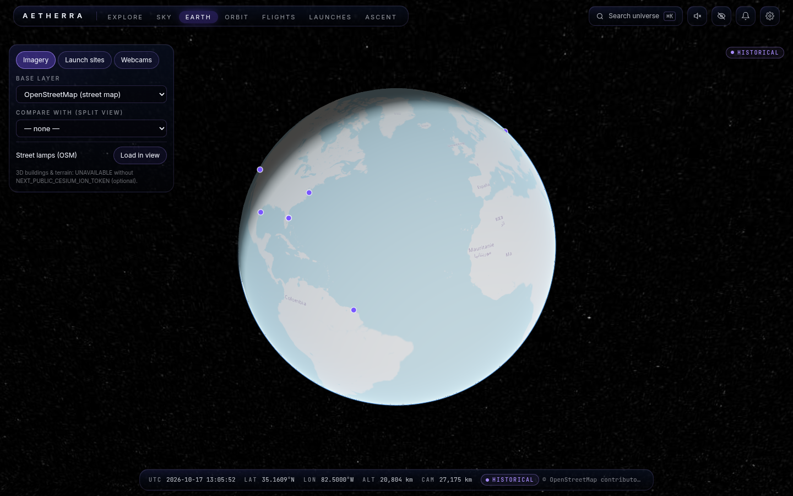
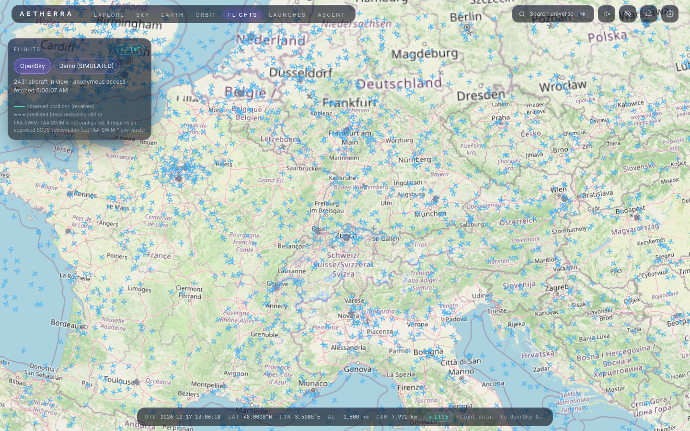
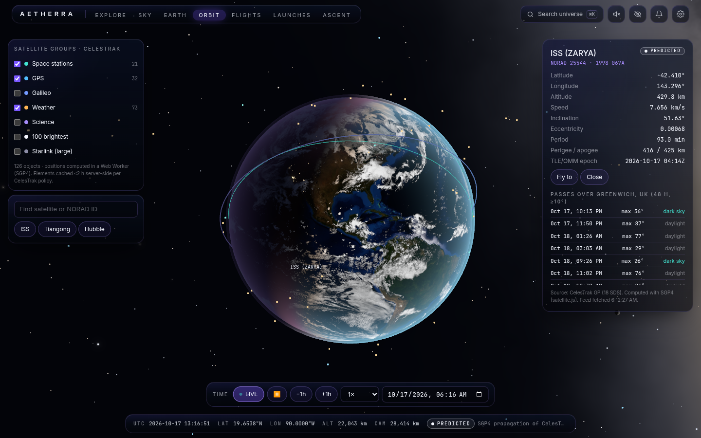
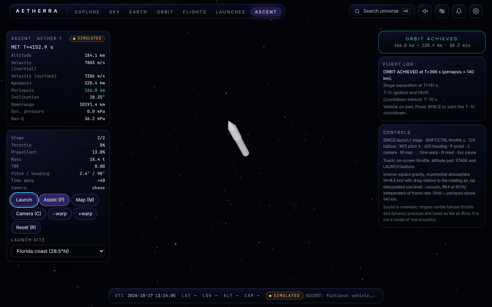
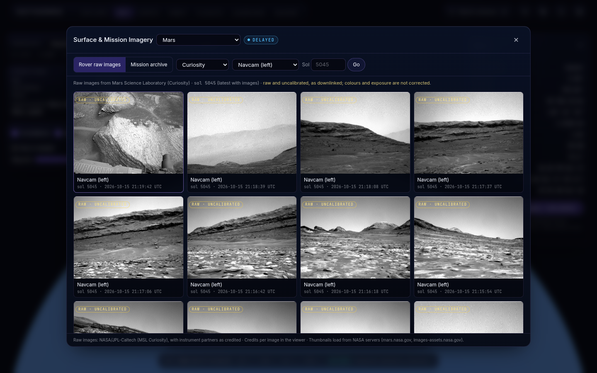
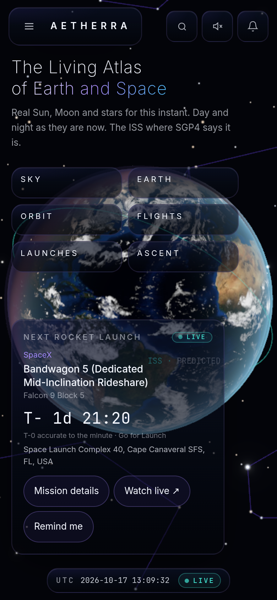

<div align="center">

# AETHERRA

### From Streetlight to Starlight.

**A real-time interactive planetarium, Earth visualization, orbital simulator, flight tracker, and space exploration platform — in one seamless universe.**

[](https://www.typescriptlang.org/)
[](https://nextjs.org/)
[](https://react.dev/)
[](https://threejs.org/)
[](https://cesium.com/platform/cesiumjs/)
[](https://tailwindcss.com/)
[](https://nodejs.org/)
[](#testing)
[](#quick-start)



*Explore a living Earth, the real night sky, live satellites and aircraft, upcoming rocket launches — then launch your own spacecraft into orbit.*

</div>

---

## Showcase

| | |
|---|---|
|  |  |
| **SKY** — a scientifically grounded planetarium for any place and time on Earth, with 5,044 catalog stars and all 88 constellations. | **LAUNCHES** — Mission Control: real upcoming launches from Launch Library 2, live countdowns, filters, reminders and change alerts. |
|  |  |
| **EARTH** — a CesiumJS globe with NASA GIBS satellite imagery, day/night, city lights, streetlights and launch sites. | **FLIGHTS** — live aircraft from OpenSky, with observed tracks drawn solid and predicted tracks dashed. |
|  |  |
| **ORBIT** — satellites propagated with real SGP4 orbital mechanics, ground tracks and pass predictions. | **ASCENT** — fly the fictional AETHER-1 rocket to orbit on RK4 physics. Shown: ORBIT ACHIEVED, periapsis ≈ 166 km. |
|  |  |
| **Planetary imagery** — raw Mars rover photos and NASA mission archives for the Moon, planets and major moons, with full credit and provenance. | **Mobile** — touch-first controls, bottom-sheet panels and on-screen flight controls, tested at phone and tablet sizes. |

## Highlights

- **One universe, not disconnected dashboards** — a unified camera and time system moves you from a streetlight to a star.
- **Data honesty by design** — every value is labelled `LIVE`, `DELAYED`, `HISTORICAL`, `PREDICTED`, `SIMULATED` or `UNAVAILABLE`. Simulated data is never presented as live.
- **Real astronomy** — Sun, Moon and planet positions computed with [Astronomy Engine](https://github.com/cosinekitty/astronomy); satellites propagated with SGP4 from CelesTrak elements.
- **Real launches** — schedules, countdowns, schedule-change detection, calendar (ICS) export, in-app inbox and Web Push reminders.
- **A playable orbital simulator** — two-stage rocket, fixed-step RK4 physics independent of frame rate, staging, apoapsis/periapsis HUD and an assist autopilot that genuinely reaches orbit.
- **Cinematic presentation** — skippable intro, Fresnel atmosphere, Milky Way, quality presets (Low → Ultra / Auto), procedurally synthesized sound (muted by default), and a hide-UI screenshot mode.
- **Responsive and accessible** — keyboard navigation, reduced-motion support, 44 px touch targets, and automated layout audits on four viewports.

## Modes

| Mode | Route | What it does | Primary data |
|---|---|---|---|
| **Explore** | `/` | 3D Earth with real day/night, city lights, the Sun and Moon, stars by sidereal time, the ISS and the next-launch countdown | Astronomy Engine, CelesTrak, Launch Library 2 |
| **Sky** | `/sky` | Planetarium for any observer and time: stars, constellations, planets, rise/set times, inspection panels, planetary imagery galleries | Computed locally; NASA imagery |
| **Earth** | `/earth` | CesiumJS globe with NASA GIBS imagery layers, date scrubbing and split compare, launch sites, streetlights, public webcam directory | NASA GIBS, OpenStreetMap |
| **Orbit** | `/orbit` | Satellite groups propagated in a Web Worker, orbit lines, ground tracks, satellite search and pass predictions | CelesTrak GP + SGP4 |
| **Flights** | `/flights` | Live aircraft with interpolated motion, observed vs. predicted tracks and a flight-follow view; clearly labelled simulated demo when no provider is configured | OpenSky Network |
| **Launches** | `/launches` | Mission Control: upcoming and past launches, countdowns, filters, mission pages, reminders and livestream links | Launch Library 2 |
| **Ascent** | `/ascent` | Interactive spacecraft launch simulator with realistic orbital mechanics | Simulated |
| **Status** | `/status` | Live health and staleness of every data provider | All providers |

## Tech stack

| Area | Technology |
|---|---|
| Language | TypeScript 5 |
| Framework | Next.js 16 (App Router), React 19 |
| 3D — space | Three.js, React Three Fiber, drei, postprocessing |
| 3D — Earth | CesiumJS |
| Astronomy / orbits | Astronomy Engine, satellite.js (SGP4) |
| State / styling | Zustand, Tailwind CSS 4 |
| Backend | Next.js route handlers, Node.js, Web Workers |
| Database | PostgreSQL + Drizzle ORM (embedded PGlite fallback, no setup required) |
| Notifications | Web Push (VAPID), in-app inbox, ICS calendar feeds |
| Testing | Vitest, Playwright |
| Data providers | Launch Library 2, CelesTrak, OpenSky, NASA GIBS, NASA Image Library, NASA/JPL rover feeds, OpenStreetMap |

## Data sources & honesty

AETHERRA wraps every external service in a typed provider adapter with licensing, attribution, caching, backoff and staleness reporting. Highlights:

- **Launches** refresh within Launch Library 2's rate budget; countdowns show the precision of the published time — an estimated date is never shown as an exact liftoff time.
- **Mars rover images** come from NASA/JPL's raw-image feeds and are labelled raw and uncalibrated; archive imagery carries its library record date and credit.
- **Aircraft** positions are observations; anything extrapolated is drawn differently and labelled. There is no global feed of private cars or private cameras, and AETHERRA does not pretend otherwise — city vehicles would be labelled simulated, and webcams link only to official public portals.
- **FAA SWIM** is an adapter stub that reports `UNAVAILABLE` until an authorized subscription is configured.

Full details: [docs/providers.md](docs/providers.md) · [docs/privacy.md](docs/privacy.md) · [docs/attribution.md](docs/attribution.md)

## Quick start

```bash
npm install                 # also copies Cesium static assets to public/cesium
cp .env.example .env.local  # optional — every integration has an honest fallback
npm run dev                 # http://localhost:3000
```

Production:

```bash
npm run build && npm start
```

No database server? Set nothing: without `DATABASE_URL` the app uses an embedded database in `./.data/`. Web Push reminders need VAPID keys (`npx web-push generate-vapid-keys`); without them, reminders still arrive in the in-app inbox. Handy while exploring: `?nointro` skips the intro, and `H` hides the UI for screenshots. See [.env.example](.env.example) for every option.

## Testing

```bash
npm run lint && npm run typecheck && npm test   # ESLint, TypeScript, 71 unit tests
npm run e2e                                     # 79 Playwright tests on desktop, iPhone, Android and iPad viewports
npm run screenshots:polish                      # refresh the screenshots used above
npm run screenshots:imagery
```

Unit tests cover coordinate transforms, astronomy against known references, SGP4 against published vectors, flight interpolation, orbital-energy conservation (including a full simulated flight to orbit) and the launch pipeline (change detection, deduplication, reminders, time zones). The e2e suite audits every page for horizontal overflow, console errors and tap-target size, and flies ASCENT to orbit in a real browser.

## Documentation

- [Architecture](docs/architecture.md)
- [AETHERRA Voice](docs/voice.md) — rendering engines, coordinate systems, provider design
- [Providers](docs/providers.md) — every data source, its licence, quota and fallback
- [API](docs/api.md) — route contracts
- [Privacy](docs/privacy.md) — what is collected (very little) and why
- [Attribution](docs/attribution.md) — credits for data, catalogues and imagery
- [Known limitations](docs/known-limitations.md) — read this before trusting a number
- [Roadmap](docs/roadmap.md) — where AETHERRA goes next

## Project status

AETHERRA is an actively developed showcase build. The core experience — Earth, sky, orbits, flights, launches, planetary imagery and the ASCENT simulator — works end to end on real data, with automated tests and a green production build. Known gaps (authorized FAA data, embedded webcams, 3D buildings without a Cesium ion token) are listed honestly in [known limitations](docs/known-limitations.md).

Imagery and data remain © their respective providers (NASA, JPL-Caltech, ESA and others) — see [attribution](docs/attribution.md).

<div align="center">

**AETHERRA — From Streetlight to Starlight.**

</div>
